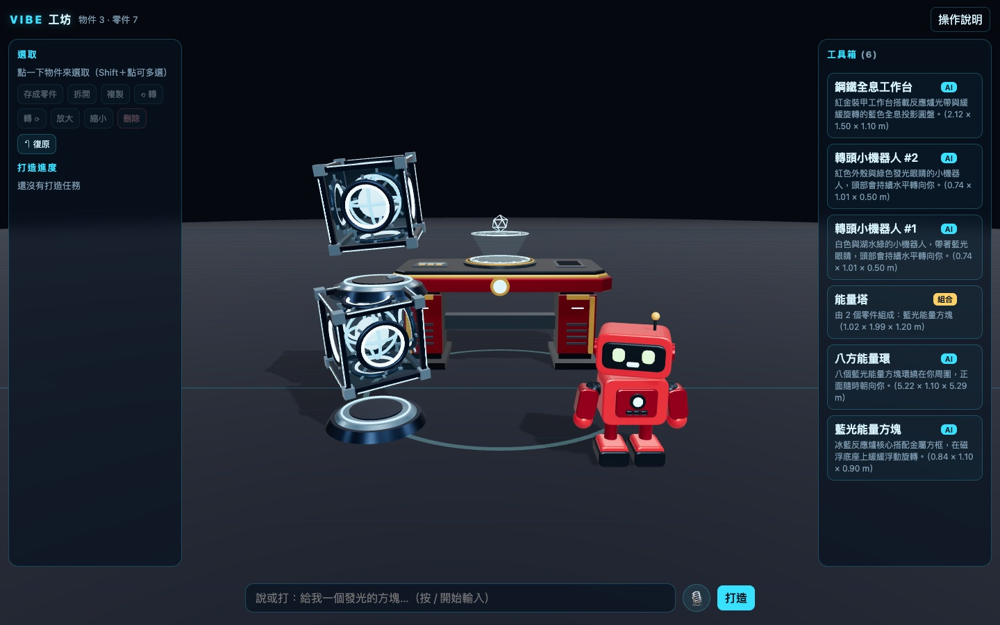
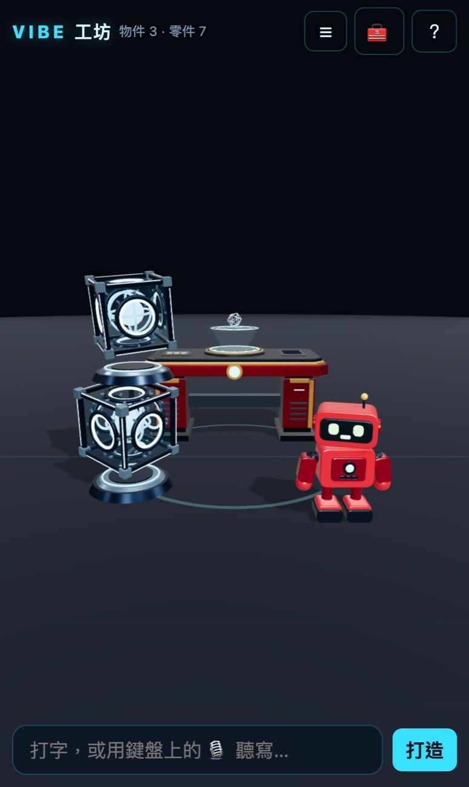
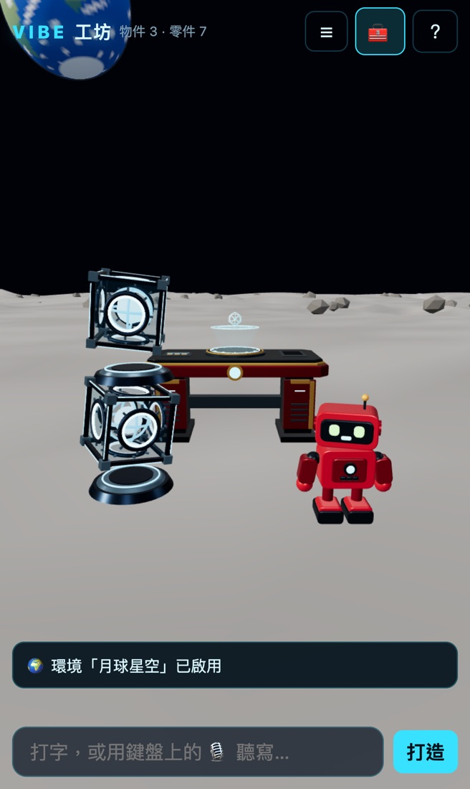
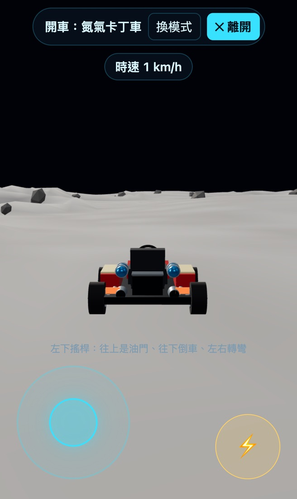
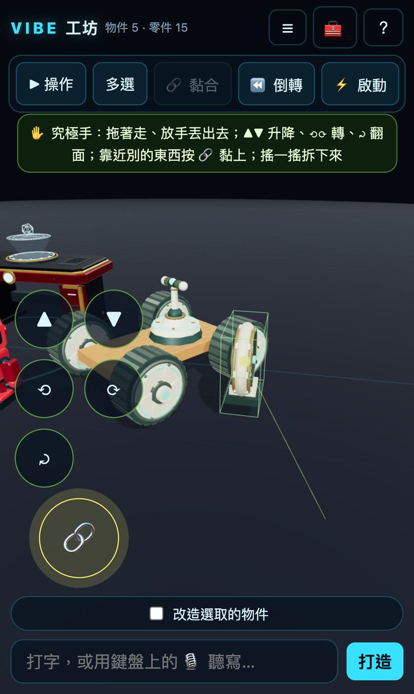
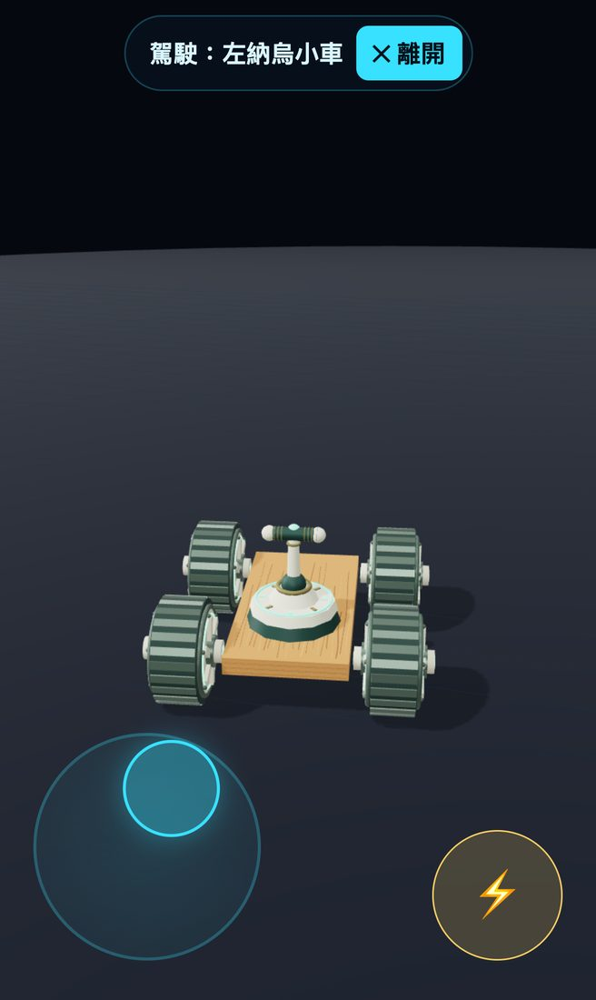
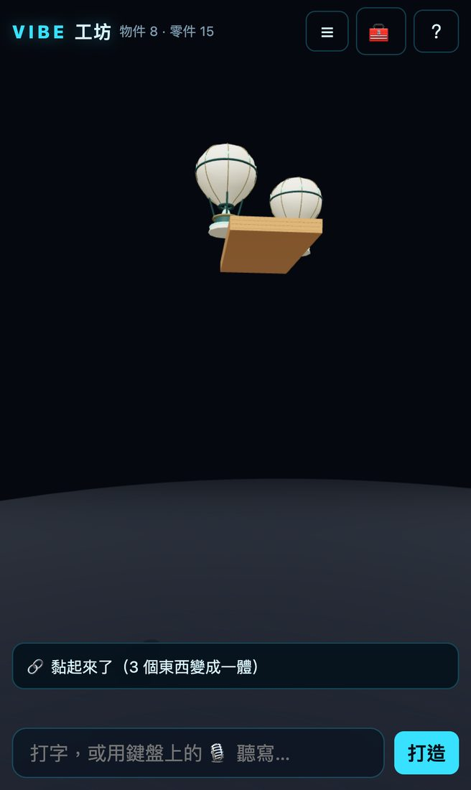
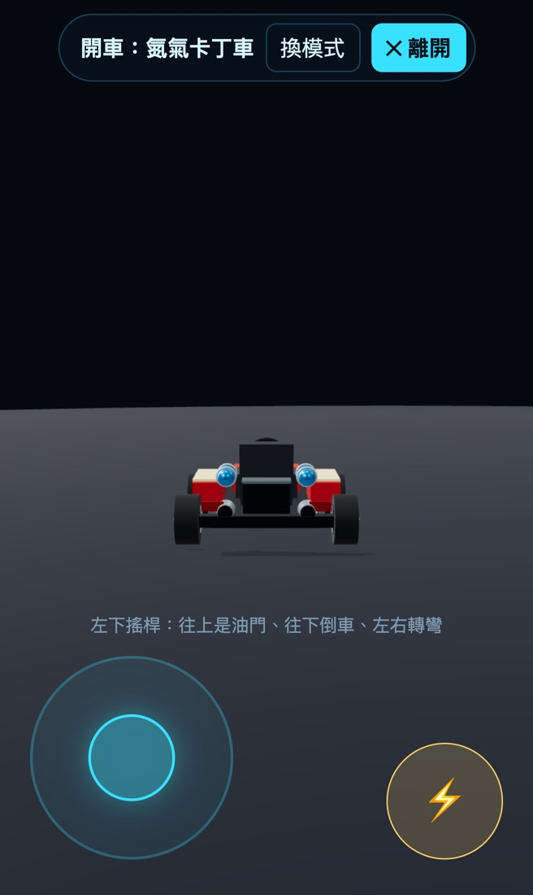
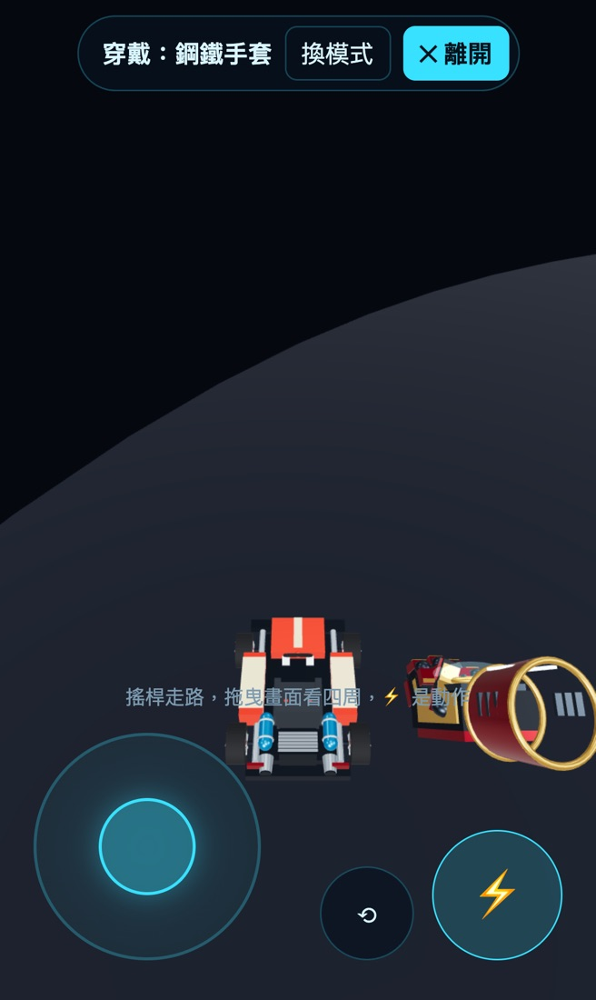

# Vibe 工坊

[English](README.md) · **繁體中文** · [हिन्दी](README.hi.md)

在 3D／VR 世界裡跟 AI 說話打造東西，就像鋼鐵人在自己的工作室。
說一句「給我一個發光的能量方塊」，幾十秒後它就出現在你面前。
把做好的東西疊起來、存成新零件，再叫 AI 拿這些零件**當材料**做出新東西。
不用重新整理、不用重新打包，你一直待在這個世界裡。



## 功能

- **做一個遊戲，找朋友一起玩**：在「🎮 遊戲房」用按鈕選能量槍（顏色、射速）、標靶（幾個、會不會動）和怎樣算贏（先拿到 N 分，或 30／60／90 秒內分數最高）——不用寫程式、也不用 AI。開一個房間，同一個 Wi-Fi 的朋友點一下就加入。分數、倒數、計時和標靶位置都由伺服器決定，所以大家看到的遊戲和結算都一樣。房主可以改規則再玩，遊戲會存起來。
- **會做事的道具**：跟裝置一樣，零件可以在 `meta.json` 宣告行為：`tool`（瞄哪裡就射哪裡的能量槍）或 `target`（標靶）。內建的「能量槍」「標靶」到哪都能用：在自由工坊拿起能量槍，打到東西會把它撞開。Codex 也能做新的。
- **三關新手教學**：「小紅的信號塔」用內建零件教你拿、組、開：把能量方塊搬到充電座、把輪子和操縱桿裝到木板上試車，再開車穿過兩個能量環。有救援按鈕、重新整理接著玩、結算和再玩一次。
- **用說的或打字就能打造**：[OpenAI Codex CLI](https://github.com/openai/codex) 當場寫出一個 three.js「零件」，通過驗收後直接放進正在跑的世界。
- **疊起來、組起來**：把物件拖到另一個上面就會疊上去；選好幾個，就能存成可以重複使用的零件。
- **拿做好的東西再做新的**：AI 做的零件可以用 `ctx.spawn(...)` 叫出其他零件，最多套 8 層。
- **原地改造**：選一個 AI 做的物件，說「改成紅色」，新版本會在原位置換上。
- **連世界本身都能改**：說「把這裡變成月球表面」或「加上重力」，Codex 會寫出環境或規則，當場換進正在跑的世界。連開車引擎都能被規則改掉（「車子開快一點而且會甩尾」）。
- **真的物理，借鏡《薩爾達傳說：王國之淚》**：東西會掉、會倒、會被撞開。用究極手抓起來、丟出去、黏成裝置，裝上風扇、輪子、氣球、火箭，開走自己做的載具，還能用時光倒轉讓東西退回去。
- **照照片做**：按 📷 從相簿挑一張（或直接拍），按「打造」就好，也可以加幾個字（「做成玩具大小」）。手機會先把照片縮小、拿掉拍攝地點再送出；Codex 照著照片裡的主角做，做完還會拿成品跟照片比對。
- **AI 會檢查自己的作品**：交件前，Codex 會看自己做的東西的四個角度；驗收程式會抓出它亂編的指令，裝置還會在物理引擎裡實際開一開。工具箱每個零件都有縮圖。
- **做出來的東西能開、能飛、能戴**：選一個物件按「▶ 操作」：車子能開、飛天車能飛、手套能戴在手上。手機有拇指搖桿和 ⚡ 動作鍵，電腦用 WASD 和空白鍵。
- **全部自動存檔**：場景和工具箱都會自動儲存，關掉分頁之後再開都還在。
- **電腦、手機、VR 都能用**：滑鼠鍵盤、適合手機的觸控版面，以及實驗中的 WebXR 模式（用手把抓起來、疊上去）。



## AI 是怎麼做出 3D 模型的

Codex 不是在生成網格或圖片，而是**寫 60～80 行的 JavaScript**，用基本形狀（方塊、圓柱、球、圓環、旋轉曲面、擠出形狀）照公尺尺寸一塊塊組出物件，再加上金屬或發光材質，需要的話還會寫動畫。

每次打造都會開一個小小的工作資料夾，裡面有六樣東西：

| | 內容 | 作用 |
|---|---|---|
| 1 | 任務單（[`server.mjs`](server.mjs) 的 `taskPrompt()`） | 幾行字：使用者說了什麼、要新做還是改造，以及「先看最接近的範例，寫出 `part.js` 和 `meta.json`，跑驗收直到 PASS，再看一眼照片」。 |
| 2 | [`fabricator/AGENTS.md`](fabricator/AGENTS.md) | 施工規格書：單位公尺、原點在底部中心、正面朝 +Z、`ctx` 介面、動畫寫法、物理與裝置、效能預算、禁止使用的功能、擺放規則。 |
| 3 | [`fabricator/examples/`](fabricator/examples) | 七個做對了的範例（車、手套、風扇裝置、用現成零件排的圓環、一個環境、兩個規則）。Codex 會先打開最接近的那個；另有測試確保範例一直都能通過驗收。 |
| 4 | `context.json` | 使用者說的話、選了什麼、附近有什麼——連同每個東西「是什麼」（說明、能不能開、是不是裝置、會不會動、有沒有黏著）——使用者站在哪、工具箱裡每個零件的名字和尺寸，有附照片的話還有照片（`reference.jpg`，叫 Codex 時也會直接附上）。 |
| 5 | [`fabricator/validate.mjs`](fabricator/validate.mjs) | 真的在 Node 裡把零件組出來、跑 90 格動畫；檢查尺寸、貼地、預算和禁止的功能；讀到不存在的 `ctx`／`world` 成員（AI 亂編的）就判不及格；提醒還留著 TODO 或空殼的程式；把零件丟到地上看會不會倒；裝置還會放進真的物理引擎開一開（風扇推不推得動、氣球會不會浮、噴射裝置黏在木筏上會不會把它掀翻、四個這種輪子裝上木板開不開得動）。卡住超過 10 秒就判失敗。 |
| 6 | [`fabricator/snapshot.mjs`](fabricator/snapshot.mjs) | 「看看自己做的東西」：伺服器把正面、側面、上方、斜角拍成 `snapshot.png`，Codex 用看圖工具打開，對照使用者要的東西檢查。Codex 的沙盒裡開不了瀏覽器，所以工作資料夾和伺服器用「傳紙條」交接。 |

Codex 自己跑驗收直到 PASS；伺服器收件前會再驗一次，沒過就把錯誤交給一個新的 Codex 再修一次。如果是 OpenAI 那邊太忙（429、模型滿載），會等一下自動重跑（不算一次），排隊中的工作也先緩一緩；如果是 Codex 額度用完，就直接說額度用完，不白白重試。

「套層」其實就是程式。八個能量方塊排成一圈，核心大概就是這樣：

```js
for (let i = 0; i < 8; i++) {
  const angle = (i / 8) * Math.PI * 2;
  const cube = ctx.spawn('藍光能量方塊'); // 工具箱裡現成的零件
  cube.position.set(Math.sin(angle) * 2.2, 0, -Math.cos(angle) * 2.2);
}
```

環境和規則是 `world.js` 模組：`install(world)` 拿到一組受控的介面（`world.add`、`world.env`、`world.objects()`、`world.vehicle.tune()`、`world.hud()`⋯），模組放進世界的東西，在它被拔掉時會自動清乾淨。

零件也可以在 `meta.json` 宣告 `controls`（`drive`／`fly`／`wear`），再用 `root.userData.onControl(s, dt)` 對搖桿做出反應，例如輪子轉動、煞車燈、握拳。

物理開著時，每個零件都是剛體。零件可以在 `meta.json` 宣告 `physics`（重量、摩擦、彈性、固定不動）和左納烏式的 `device`（風扇、火箭、氣球、輪子、彈簧、操縱桿），再用 `root.userData.onDevice(s, dt)` 做動畫。驗收程式也會把每個零件放到地上 3 秒，告訴 Codex 它站不站得穩。

## 需要什麼

- Node.js 20 以上
- 已安裝並登入的 [OpenAI Codex CLI](https://github.com/openai/codex)（終端機打 `codex` 找得到）。每次打造都會用掉你的 Codex 額度。
- 新版瀏覽器（Chrome、Edge 或 Safari）
- 選用：支援 WebXR 的頭盔瀏覽器（例如 Meta Quest），需要 HTTPS，見下方「限制與接下來」

## 快速開始

```sh
git clone https://github.com/KaneJU/vibe-workshop.git
cd vibe-workshop
npm install
npm run fetch:models   # 選用：手機眼鏡模式的手勢模型（7.8 MB，下載後核對 SHA-256；不放進 git）
npm start
```

打開 <http://localhost:5310>。首頁有「🎮 遊戲房」、新手教學和自由工坊（`/?ws`）三個入口。第一次啟動會載入一組示範場景（`examples/starter`）。在下方輸入框打你想要的東西，按 Enter。

## 操作

| 動作 | 電腦 | 手機 |
|---|---|---|
| 看 | 拖曳空白處轉視角；右鍵拖曳平移；滾輪縮放 | 一指轉視角；兩指縮放、平移 |
| 選取 | 點一下；Shift＋點可多選 | 點一下；要選好幾個先按「多選」 |
| 移動／疊放 | 拖曳物件，放到別的物件上就會疊上去（物理開著時拖曳就是究極手，見下方「物理」） | 按住拖曳 |
| 旋轉／縮放 | Q / E、R / F | 上方動作列的 ⟲ ⟳ ＋ － |
| 刪除／複製／復原 | Delete、⌘D、⌘Z | 上方動作列 |
| 存成零件 | G 或「存成零件」 | 上方動作列 |
| 打造 | 打字後按 Enter，或按 🎙 用說的 | 打字，或用鍵盤上的聽寫 |
| 改造 | 選一個 AI 做的物件，勾「改造選取的物件」，再說要怎麼改 | 同左 |

不經過 AI、直接執行的指令：「把這疊存成零件，叫砲台」「復原」「刪除」「拆開」「複製 3 個」「黏起來」「倒轉」「啟動」「打開物理」（英文也可以：*save as part called turret*、*undo*、*delete*、*ungroup*、*duplicate 3*、*glue*、*rewind*、*activate*、*physics on*）。

用什麼語言下指令都可以，零件名稱會跟著你用的語言。

## 遊戲房：做一個遊戲，大家一起玩

首頁（`/`）有三個入口：🎮 **遊戲房**（`/?games`）、**新手教學**（`/?play`）、**自由工坊**（`/?ws`）。

1. **做遊戲**（`/?edit=new`）：全部用按鈕。道具（工具箱裡有 `tool` 行為的零件，一開始就有內建的能量槍）、顏色和射速、場地（靶場或競技場）、標靶數量、會不會動（會動的靶 2 分），以及怎樣算贏：「先拿到 3／5／10 分」或「30／60／90 秒內分數最高」。💾 儲存；▶ 開房間。
2. **一起玩**（`/?room=房號`）：同一個 Wi-Fi 的朋友打開工坊，點 🎮、點你的房間就進來（不用打字）。房主按「▶ 開始比賽」：倒數 3 秒，大家第一人稱拿著能量槍——拖曳畫面把準星對到標靶、按 ⚡ 發射、搖桿（或 WASD）走路。看得到其他玩家和他們的子彈。先達到目標（或時間到分數最高）的人贏，每個人的結算畫面都一樣。
3. **改規則再玩**：房主按「✏️ 改規則」換勝利條件、標靶或射速，大家都會看到新規則，也會存回這個遊戲。重新整理會帶著分數回到房間；🚪 離開房間。

運作方式：遊戲是存在 `data/games.json` 的設定（不是程式——伺服器不執行玩家送來的任何東西）。房間在伺服器記憶體裡：倒數、計時、標靶站在哪、分數都由伺服器決定，再用 Server-Sent Events 推給每位玩家。開槍的那台判斷有沒有打中，伺服器確認合理（比賽進行中、標靶立著、沒有快過槍的射速）才加分。新手教學的進度存在 `data/adventure.json`。遊戲房和教學都只能寫自己的檔案，碰不到自由工坊的場景、工具箱和世界模組。

**外觀與手感**：遊戲房（和首頁）在一個室內訓練場裡，不再是一片黑：漸層天空、有靶道和 5／10／15 公尺標線的混凝土地面、後牆與兩側的牆（玩家走不出去）、頂上的桁架和燈、一盞有陰影的主光，標靶和人腳下有柔和的接觸陰影。能量槍像手槍一樣拿在右下、槍口對準準星，走路會微微晃、開火會後座再回正；組合零件裡有道具的話，照道具本身的大小縮放，槍不會小到看不清。開火有槍口閃光；命中有火花、衝擊波和準星上的 ✕，伺服器確認後標靶往後倒、飄出「+1」；朋友是戴頭盔、會走路、會瞄準、開火有後座的角色。短短的合成音效只在你按了東西之後才會響，🔊 可以在這台裝置上靜音。特效用共用資源重複使用。裝置太慢（連續 2 秒每格超過 40 ms）會先降解析度（很慢的時候一次降好幾階），影子最後才關、而且不在比賽中關（第一次關要重新編譯 shader，會卡一下）；順了一段時間再一階一階升回來，升上去又變慢的那一階下次要等更久、失敗兩次就不再試，不會一直跳來跳去。內建零件有 `builtinRev`：升級時只換掉改版的內建零件（例如能量槍）的程式和縮圖，網址加 `?v=` 讓瀏覽器拿到新版。

零件在 `meta.json` 寫 `"tool": { "kind": "blaster", … }` 或 `"target": { "points": 1 }` 就成了道具或標靶（見 [`fabricator/AGENTS.md`](fabricator/AGENTS.md)）；組合零件裡只要有道具，整組也是道具。在工坊任何地方用「▶ 操作」拿起來就能射：打到東西會撞開、打到標靶會計分。

## 改世界：環境與規則

不只是物件，世界本身也是由一個個模組組成，你人在裡面就能直接換掉。固定不動的只有一個很小的核心：畫面、輸入、存檔、載入模組。

| 種類 | 改的是什麼 | 可以這樣說 |
|---|---|---|
| 🌍 環境（一次一個） | 天空、地面、燈光、天氣 | 「把這裡變成月球表面」「下雨的夜晚城市」 |
| 📜 規則（可以同時好幾個） | 物理、玩法、計分、開車手感 | 「加上重力」「做一條賽道，跑三圈計時」「車子開快一點而且會甩尾」 |

不用自己選種類，Codex 會從你說的話判斷。想改正在用的模組（例如「天空換成紫色的晚霞」），Codex 會寫一個新版本把它換掉。在工具箱的「🌍 世界」分頁可以開關、移除。

安全機制：

- 模組出錯，或每一格要花超過約 8 毫秒，會被自動拔掉，世界其他部分照常運作；如果它是換版上來的，就退回上一版。
- 新模組要先在電腦上用假的世界試跑才會被接受：跑 3 秒、試開車鉤子，還會檢查中間 28 公尺的地面是平的（物件和車子都走在 y = 0）。
- 「🛡️ 安全模式」一鍵停掉所有模組；網址加 `?safe=1` 打開時，不載入任何模組。

 

## 物理：借鏡《薩爾達傳說：王國之淚》

工坊裡跑的是真的剛體物理引擎 [Rapier](https://rapier.rs/)（編譯成 WebAssembly，iPhone 也跑得動）。東西會掉、會倒、會疊、會被撞開；把卡丁車開進一堆東西裡，它們會被撞得四散。碰撞形狀直接從 AI 做的東西算出來：每個零件一個凸包，每個子零件再各一個，所以存成零件的一疊東西還是原本的形狀。物理預設是開的，在「🌍 世界」分頁的「🍎 物理」可以開關。

| 王國之淚 | 在這裡 | 手機 | 電腦 |
|---|---|---|---|
| ✋ 究極手 | 一拖曳就抓起來：東西會離地飄著、跟著手指走；放手時保留速度，用力一甩就丟出去 | 拖曳；另一隻手指按 ▲ ▼ 升降、⟲ ⟳ 轉 45°、⤾ 翻面 | 拖曳；滾輪或 ↑ ↓、Q／E、R |
| 🔗 黏合 | 抓著一個東西靠到另一個（出現黃色的線）按 🔗，兩個就變成同一個剛體；抓著搖一搖可以把那一塊拆下來，「拆開」全部分開 | 抓著時按 🔗，或「多選」後按「🔗 黏合」 | 抓著時 G 或空白鍵；L |
| ⚙️ 左納烏裝置 | 工具箱裡有風扇、火箭、氣球、馬達輪子、彈簧、操縱桿（也可以叫 Codex 做新的），黏到木板上就是載具 | 選它按「⚡ 啟動」，或按「▶ 操作」用搖桿駕駛 | 空白鍵；駕駛時 WASD |
| ⏪ 時光倒轉 | 剛剛動過的東西沿著原路退回去 | 「⏪ 倒轉」 | T |
| 📐 建造藍圖 | 做好的載具按「存成零件」，之後從工具箱拿出來照樣能動：輪子會轉、風扇會吹。工具箱裡有一台現成的「左納烏小車」 | 工具箱 | 工具箱 |

裝了操縱桿的東西可以像開車一樣駕駛，搖桿往左往右就是轉向，還會幫你保持平衡、不容易翻車。氣球一直往上浮（最高約 12 公尺），風扇開著時一直推，火箭噴大約兩秒，彈簧一次大跳。

規則也能用物理：說「月球重力」，Codex 寫的是 `world.physics.gravity(-1.6)`；說「所有東西跳一下」，就是 `world.physics.push(...)`。重新打開頁面時擺設會照舊：東西在原地「睡著」，浮在空中的也一樣，等到有東西碰到它才會動。

  

## 站在別人的肩膀上

「用說的把世界變出來」不是我們第一個做的。我們借了這些點子（並註明出處）：

| 來源 | 學了什麼 |
|---|---|
| [微軟 LLMR](https://github.com/microsoft/LLMR)（CHI 2024）：用說的在 Unity 場景裡造物件和行為 | 告訴 AI 每個東西「是做什麼的」，不只位置；失敗時帶著錯誤再修一次；用固定題目量成績（`npm run bench`），不憑感覺 |
| [Google XR Blocks／Vibe Coding XR](https://github.com/google/xrblocks)（2026）：Gemini 一句話做出 WebXR 小程式 | 規格書旁邊放做對的範例；抓出 AI 亂編的 API；測「實際用起來」，不只測「打得開」 |
| [Meta Immersive Web SDK](https://github.com/facebook/immersive-web-sdk) 和 [IWER](https://github.com/meta-quest/immersive-web-emulation-runtime) | 用模擬的 Quest 3 測 VR 模式（`npm run test:xr`），抓到一個真的 bug：物理開著時用手把抓東西，東西會跳開 2.4 公尺；現在 VR 抓取改走究極手，跟他們「抓取交給物理」的設計一樣 |
| [LLMER](https://arxiv.org/abs/2502.02441) | 還沒採用：簡單的規則讓 AI 填設定、不寫程式，比較不會壞 |

我們不一樣的地方：世界會留住你做的每樣東西（疊起來、存成零件、再拿來做新東西）、玩起來像王國之淚，而且瞄準一般人的 iPhone 加上自己的 AI 訂閱。

## 操作：開車、飛行、穿戴

選一個物件按 **▶ 操作**，或直接說「開車」「起飛」「戴上」。

| 模式 | 會發生什麼 | 手機 | 電腦 |
|---|---|---|---|
| 🚗 開車 | 鏡頭跟在車子後面 | 左下搖桿：往上油門、往下倒車、左右轉彎 | W／S、A／D |
| 🛸 飛行 | 跟開車一樣，再加上升降；轉彎時機身會傾斜 | 搖桿＋▲▼ | WASD＋E／Q |
| 🧤 穿戴 | 東西戴在右手、用第一人稱看；可以走路、看四周 | 搖桿走路、拖曳畫面看四周、⟲ 轉一下手上的東西 | WASD、拖曳 |
| 🕹️ 駕駛 | 裝了裝置的東西：由物理推動，靠輪子、風扇、火箭出力 | 搖桿往上出力、左右轉向；⚡ 開關裝置（火箭、彈簧按一下就發動） | W／S、A／D、空白鍵 |

裝了裝置（風扇、輪子⋯）的東西，按「▶ 操作」會直接進入 🕹️ 駕駛。

⚡（空白鍵）是動作鍵。照新規格做的零件會自己宣告怎麼操作，並用自己的 `onControl` 做出反應：示範的卡丁車輪子會滾、前輪會轉向、倒車煞車燈會亮、按 ⚡ 噴氮氣；示範的手套會握拳、發出強光。舊零件會從名字猜操作方式，猜不出來就跳出選單問你。按「✕ 離開」或 Esc 離開。手機操作以 iPhone 為主設計和測試。

彩蛋：戴上名字叫「無限手套」的東西，按 ⚡。

 

## 用手機看（同一個網路）

1. 用 `HOST=0.0.0.0 npm start` 啟動（或安裝背景服務時加 `--lan`）。
2. 會在 `data/access-key` 產生一組通行碼。
3. 手機打開 `http://<電腦的 IP>:5310/?key=<通行碼>` 一次，之後這支手機會記住一年。

在電腦本機開不需要通行碼。其他裝置都要通行碼，而且不是私人網段的位址一律擋掉。

## 手機眼鏡模式（紙盒頭戴）

自由工坊右上角的「👓 眼鏡」：把手機橫放進紙盒眼鏡（Cardboard 一類），坐著轉頭看自己的作品，手伸到手機背面的鏡頭前——張開手、指向東西、拇指捏食指就抓起來，張開手指放下。抓的是工坊裡同一批作品、同一套物理，放下後照常存檔。

- 左右眼各有自己的視點與偏軸投影（不是同一張畫面複製兩次），世界與物理每格只更新一次；鏡片畸變、瞳距、鏡片中心距、鏡頭視角、手的遠近比例都能在設定面板調，並有校正圖。手機型號與鏡片還沒指定，預設值標示「未校正」。
- 手勢辨識用 [MediaPipe Hand Landmarker](https://ai.google.dev/edge/mediapipe/solutions/vision/hand_landmarker)（`@mediapipe/tasks-vision` 鎖在 0.10.35：1.x 版內建會把使用量指標送到 Google）。影像只在手機上推論：程式、WASM、模型都由工坊自己的伺服器提供，worker 只准連回本機伺服器，不上傳、不存檔。
- 戴著摸不到螢幕按鈕：低頭盯著「⟳ 回正／▦ 校正圖／✕ 離開」1.5 秒就會按下；按住螢幕 1.2 秒也會離開。追丟手、關鏡頭、切到背景、手機轉直、離開時，手上的東西一律原地放下（不會被甩出去），之後要先張開手才抓得起來。
- iPhone 只在安全連線（https 或這台電腦本機）給鏡頭和動作感測；用區網的 http 連時只能拖曳畫面看，畫面上會寫原因。這是坐著轉頭（3DoF），不是空間定位；手的遠近是單眼估計。

## 設定

| 環境變數 | 預設 | 說明 |
|---|---|---|
| `PORT` | `5310` | 網頁埠號 |
| `HOST` | `127.0.0.1` | 設成 `0.0.0.0` 讓同網路的手機連得到（要通行碼） |
| `DATA_DIR` | `./data` | 場景、工具箱、生成的零件、通行碼 |
| `CODEX_BIN` | `codex` | Codex CLI 的路徑 |
| `CODEX_MODEL` | Codex 預設 | 傳給 `codex exec -m` 的模型 |

## 在背景常駐（macOS）

```sh
./launchd/install-macos.sh          # 只有這台電腦能用
./launchd/install-macos.sh --lan    # 同網路的手機也能用
```

會裝一個 LaunchAgent：開機登入後自動啟動，當掉會自己重開。移除方法：

```sh
launchctl bootout gui/$(id -u)/com.vibeworkshop.server
rm ~/Library/LaunchAgents/com.vibeworkshop.server.plist
```

## 安全須知

- AI 寫的程式會在你的瀏覽器分頁裡執行。這是給自己玩的創作工具，不是給陌生人用的沙盒。
- Codex 以 `--sandbox workspace-write` 執行，只能寫入 `jobs/` 底下該次任務的資料夾。
- 伺服器預設只聽本機。區網模式要通行碼，而且網址必須指名這台電腦（防 DNS rebinding）。
- 不要開放到公開網路上。

## 測試

測試會改動場景，所以要對一個用完即丟的資料夾跑（空資料夾第一次啟動時，會自動放入測試會用到的示範零件）：

```sh
npx playwright install chromium
rm -rf /tmp/vw-test-data
DATA_DIR=/tmp/vw-test-data PORT=5311 HOST=0.0.0.0 npm start &
npm test                 # 電腦版：疊放、存成零件、刪除與復原、重新整理還在
npm run test:mobile      # 模擬 iPhone 走區網：通行碼、抽屜、手指拖曳、多選
npm run test:control     # iPhone：開車、換成飛行、穿戴、選單、彈指；再加電腦 WASD
npm run test:world       # iPhone：月球、重力、甩尾、出錯隔離、換版退回、太慢自動拔掉、安全模式
npm run test:physics     # iPhone：掉落與疊放、究極手、黏合、搖一搖拆下、風扇、氣球、操縱桿小車、時光倒轉、改重力的規則、重新整理
npm run test:xr          # 模擬 Quest 3（IWER）進 VR：手把抓、跟著走、轉手腕、放開、手勢捏——物理開關各一輪
npm run test:photo       # iPhone 從區網按 📷：照片縮小、拿掉拍攝地點、叫 Codex 時附上（自己開一台用假 Codex 的伺服器）
npm run test:examples    # fabricator/examples 裡每個範例都要通過真的驗收（不用開伺服器）
npm run test:headset     # 眼鏡模式：雙眼與轉頭、手勢狀態機（合成）、假鏡頭＋真模型推論、追丟安全放下、存檔重開（自己開 127.0.0.1 的伺服器）
npm run test:flash       # 開火閃光在畫面上的大小（不用開伺服器；tests/flash-probe.mjs 在真的遊戲房裡量）

# 新手教學與遊戲房：各用一個丟棄式資料夾、只聽 127.0.0.1（CODEX_BIN 故意指到不存在的地方）
DATA_DIR=/tmp/vw-adv-data PORT=5312 HOST=127.0.0.1 CODEX_BIN=/nonexistent/codex npm start &
npm run test:adventure   # 手機和電腦從首頁用真的觸控／滑鼠玩完教學：救援、重新整理、再玩一次、工坊檔案沒被動到、0 個 AI 工作
DATA_DIR=/tmp/vw-room-data PORT=5313 HOST=127.0.0.1 CODEX_BIN=/nonexistent/codex npm start &
BASE=http://127.0.0.1:5313 npm run test:rooms    # 兩個玩家走 HTTP＋SSE：倒數、標靶、分數、結算一致；改規則；重連；房間隔離
BASE=http://127.0.0.1:5313 DATA_DIR=/tmp/vw-room-data npm run test:coplay   # 一台手機＋一台電腦的瀏覽器：做遊戲、加入、射靶、共享結算、改規則再玩、離開、重開
BASE=http://127.0.0.1:5313 npm run test:tools    # 在自由工坊拿能量槍：瞄準、打中標靶、把它撞開、按住連射
npm run test:builtin-refresh   # 舊工坊升級：只換改版的內建零件，玩家自己組的零件和場景都不變
npm run test:quality          # 自動畫質：規則（模擬每格時間）、真的遊戲房慢 → 快（解析度和影子都升回來）、軟體繪圖下降級過渡和穩定分開量
SERVER_ROOT=. OUT=tests/out/visual npm run visual          # 同視角截圖（手機＋電腦、固定房號和標靶位置）＋每格時間；GPU=1 用 Mac 的顯示卡
SERVER_ROOT=. VIEW=m node tests/perf-scene.mjs             # 同一個遊戲場景在 GPU、不限影格下的繪圖成本（比較兩個版本）
SERVER_ROOT=. node tests/record.mjs                         # 錄手機和電腦各一段：走路、瞄準、開火、命中
WITH_CODEX=1 npm run bench   # 固定題目（SET=hard 換成會開、會飛、能戴、裝置、規則的難題）：成功與否、時間、驗收輪數、每個成品拍照，再用現在的驗收和 ⚡ 試用一次（會用 Codex 額度）
WITH_CODEX=1 npm test    # 再加跑一次真的打造和改造（會用 Codex 額度）
```

`npm test` 和 `test:mobile` 用 `?physics=0` 打開，測沒有物理時的經典擺放；其他測試都開著物理跑。

## 專案結構

```
server.mjs              網頁伺服器、存檔、派工給 Codex、通行碼
fabricator/AGENTS.md    給 Codex 的零件規格書
fabricator/validate.mjs 零件驗收程式（Codex 也會自己跑）
fabricator/examples/    Codex 開工前先看的範例
fabricator/snapshot.mjs  「看看自己做的東西」（請伺服器拍 snapshot.png）
fabricator/snapshotter.mjs  伺服器端的拍照程式（給 Codex 看的照片、工具箱縮圖）
public/runtime.mjs      瀏覽器和驗收共用的零件組裝核心（套層與數量上限）
public/app.js           工坊本體：場景、選取、拖曳疊放、工具箱、語音、WebXR；決定開哪個畫面（首頁、教學、遊戲房、工坊）
public/adventure.mjs    新手教學：三關、吸附、救援、結算
public/game.mjs         瀏覽器端的遊戲房：大廳、玩法編輯器、房間（等人、第一人稱、計分板、結算）
public/tools.mjs        瀏覽器和驗收共用的道具行為：能量槍的子彈、命中、標靶
rooms.mjs               伺服器端的遊戲定義與房間：倒數、計時、標靶、分數、SSE
public/control.mjs      操作引擎：開車、飛行、穿戴（搖桿、按鈕、鍵盤）
public/worldhost.mjs    世界模組宿主，瀏覽器和驗收共用（隔離、清理、效能看門狗）
public/worlds.mjs       「🌍 世界」分頁：開關、退回上一版、安全模式
public/physics.mjs      瀏覽器和驗收共用的物理：Rapier 剛體、究極手、黏合、裝置、時光倒轉
public/headset.mjs      手機眼鏡模式：把雙眼畫面、轉頭、後鏡頭手勢接到同一個世界與物理
public/stereo.mjs       雙眼畫面（每眼偏軸投影、鏡片畸變校正、校正圖）
public/headpose.mjs     手機方向感測 → 頭部姿勢（橫放、回正、沒有感測時拖曳）
public/handtrack.mjs    後鏡頭與手勢 worker 的生命週期（限頻、丟掉過期結果、暫停時關鏡頭）
public/handworker.mjs   在 worker 裡跑 MediaPipe（不連外）
public/hands.mjs        21 個關鍵點 → 捏合、位置、遠近；抓放狀態機（遲滯、防抖、上膛、追丟）
public/headsethud.mjs   頭戴介面：狀態板、視線按鈕、手的骨架與射線
public/legal.html       授權與第三方聲明
scripts/fetch-models.mjs  下載並核對手勢模型
public/index.html       頁面與操作說明
examples/starter/       第一次啟動時載入的示範零件與場景
launchd/                macOS 背景服務範本與安裝腳本
tests/                  Playwright 測試（電腦版與手機版）
```

## 限制與接下來

- 介面目前只有繁體中文。
- VR 模式已經用模擬的 Quest 3 測過（抓、移動、轉、放開、手勢捏），還沒在真的頭盔上測，VR 裡也還不能用說的打造。
- 附上的照片會跟打的字一樣，隨 Codex 的請求送到 OpenAI；Mac 上的工作資料夾（`jobs/`，不進 git）會留一份。
- 頭盔要 HTTPS 才能進 WebXR，瀏覽器也要 HTTPS 才給網頁用麥克風。在區網用 http 連時，請改用手機鍵盤的聽寫。
- AI 看的是四張靜態照片，還不會看動畫、也不會用眼睛試操作。縮圖和照片需要 Playwright 的 Chromium（`npx playwright install chromium`）；沒有的話其他功能照常。
- 碰撞形狀是凸包：桌子的桌腳和桌面會被當成一整塊實心的。用好幾個子零件組成（或黏起來）的東西，會保留真正的形狀。
- 物理是在每個打開的頁面裡算的。同一時間請只在一台裝置上開著工坊，不然兩邊的模擬會互相蓋掉存檔。
- VR 裡還沒有究極手，用手把抓東西還是原本簡單的抓起來、疊上去。
- VR 裡還不能用操作模式。
- 環境的中間 28 公尺地面一定要平；車子還不會沿著地形高低起伏。
- 遊戲房目前給同一台電腦或同一個 Wi-Fi 的人玩（朋友第一次要用工坊的通行碼連結打開）。還沒有讓外面網路的朋友加入的方法，也沒有帳號。
- 房間在伺服器的記憶體裡：伺服器重新啟動，開著的房間就關了（遊戲本身有存）。
- 目前只有一種遊戲（拿能量槍射靶），編輯器可以改道具、標靶和勝負規則。有沒有打中由開槍那台判斷，伺服器只檢查合不合理——朋友之間玩沒問題，但防不了作弊。
- 新手教學和遊戲房還不能在 VR 裡玩。
- 手機眼鏡模式只在自由工坊，還沒在真的 iPhone、紙盒鏡片上測過（光學融合、舒適度、發熱都待驗）；自動測試用的是 Chromium 的假鏡頭播放測試圖片，不是 iPhone 後鏡頭。iPhone 要 https 才開得了鏡頭和動作感測，目前的區網 http 入口不行。

## 授權

[MIT](LICENSE)。使用 [three.js](https://threejs.org/)、[Rapier](https://rapier.rs/)、[MediaPipe](https://ai.google.dev/edge/mediapipe) 與 [OpenAI Codex CLI](https://github.com/openai/codex) 打造。第三方元件的版本、授權與聲明見遊戲裡的「授權與第三方聲明」（`/legal.html`）。
